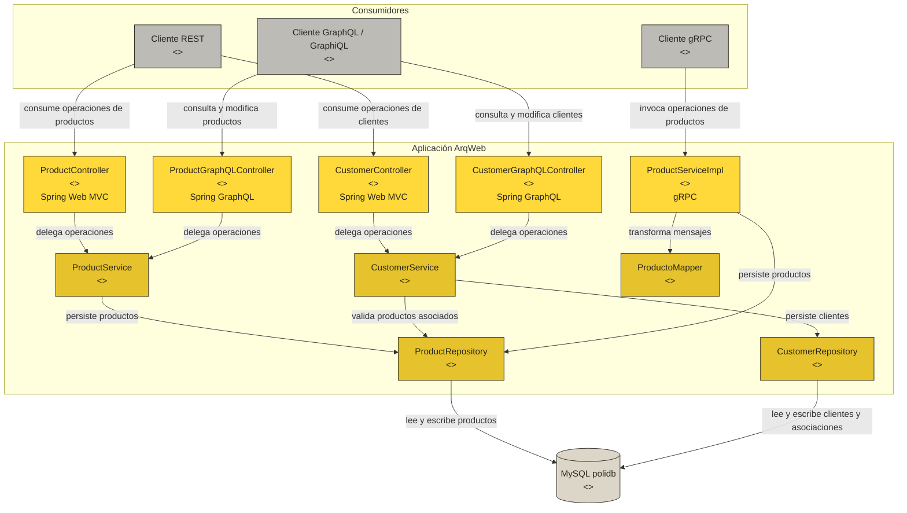
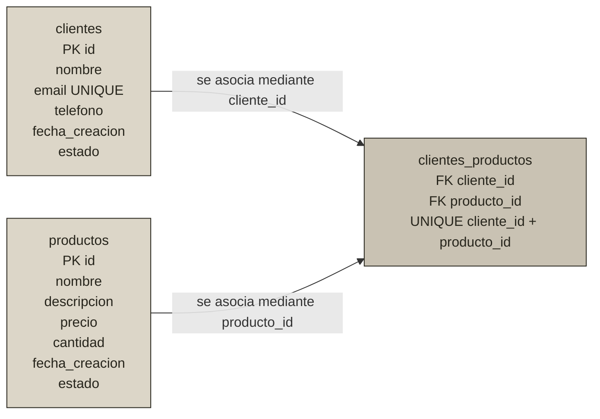

# ArqWeb — API de productos y clientes


[](https://github.com/RyukGore/arqWebUnidadII/commits/main)

Aplicación académica desarrollada con Spring Boot para administrar productos y clientes. Los productos se exponen mediante REST, GraphQL y gRPC; los clientes y su asociación con productos se exponen mediante REST y GraphQL. La persistencia de ejecución usa MySQL y las pruebas automatizadas usan H2 en memoria con compatibilidad MySQL.

## Características

- CRUD de productos mediante REST, GraphQL y gRPC.
- CRUD de clientes mediante REST y GraphQL.
- Relación muchos-a-muchos entre clientes y productos.
- Validación de datos de cliente y control de correos duplicados.
- Rechazo de asociaciones con productos inexistentes.
- Creación y actualización automática del esquema mediante JPA/Hibernate.
- GraphiQL habilitado para explorar la API GraphQL.
- Empaquetado y ejecución mediante Docker.
- Pruebas aisladas de MySQL mediante un perfil H2.

## Arquitectura



## Modelo de datos



La asociación indica que un cliente puede tener varios productos relacionados y un producto puede relacionarse con varios clientes. No representa todavía una compra: cantidades compradas, fechas, precios históricos y estados de una orden requerirían una entidad de pedido independiente.

### Tabla `clientes`

| Campo | Tipo Java | Regla |
| --- | --- | --- |
| `id` | `String` | Llave primaria, máximo 50 caracteres. |
| `nombre` | `String` | Obligatorio, máximo 150 caracteres. |
| `email` | `String` | Obligatorio, formato válido y único. |
| `telefono` | `String` | Opcional, máximo 30 caracteres. |
| `fecha_creacion` | `LocalDateTime` | Asignado automáticamente al crear. |
| `estado` | `Boolean` | Activo por defecto. |

### Tabla de relación `clientes_productos`

| Campo | Relación |
| --- | --- |
| `cliente_id` | FK hacia `clientes.id`. |
| `producto_id` | FK hacia `productos.id`. |

La pareja `cliente_id` + `producto_id` es única para impedir asociaciones duplicadas.

## Tecnologías

| Tecnología | Versión | Uso |
| --- | --- | --- |
| Java | 21 | Lenguaje y plataforma. |
| Spring Boot | 4.1.0 | Configuración y ejecución. |
| Spring Web MVC | Administrada por Spring Boot | API REST. |
| Spring for GraphQL | Administrada por Spring Boot | API GraphQL y GraphiQL. |
| Spring Data JPA | Administrada por Spring Boot | Persistencia y relaciones. |
| MySQL Connector/J | Administrada por Spring Boot | Conexión de ejecución a MySQL. |
| H2 | Solo pruebas | Base aislada en memoria con modo MySQL. |
| gRPC Java | 1.62.2 | Servicio RPC de productos. |
| Protocol Buffers | 3.25.3 | Generación de mensajes y servicios Java. |
| grpc-server-spring-boot-starter | 3.1.0.RELEASE | Integración del servidor gRPC. |
| Lombok | Administrada por Spring Boot | Código repetitivo de entidades y DTO. |
| Maven Wrapper | Incluido | Compilación reproducible. |

## Requisitos

- JDK 21.
- MySQL 8 con una base de datos llamada `polidb`.
- Git.
- Docker opcional.
- `grpcurl` opcional para probar gRPC.

## Configuración de MySQL

La configuración educativa predeterminada está versionada para que el proyecto pueda probarse sin ajustes adicionales:

| Variable | Valor predeterminado |
| --- | --- |
| `DB_URL` | `jdbc:mysql://localhost:3306/polidb?useSSL=false&serverTimezone=UTC&allowPublicKeyRetrieval=true` |
| `DB_USERNAME` | `poli` |
| `DB_PASSWORD` | `pol1Gr@n.` |

Se puede reemplazar cualquier valor mediante variables de entorno. En PowerShell:

```powershell
$env:DB_URL = "jdbc:mysql://localhost:3306/polidb?useSSL=false&serverTimezone=UTC&allowPublicKeyRetrieval=true"
$env:DB_USERNAME = "poli"
$env:DB_PASSWORD = "pol1Gr@n."
```

La configuración `spring.jpa.hibernate.ddl-auto=update` crea o ajusta automáticamente `productos`, `clientes` y `clientes_productos` al iniciar la aplicación.

> La credencial predeterminada se conserva por el carácter educativo del repositorio. No debe reutilizarse en ambientes productivos ni con información real.

## Instalación y ejecución

```bash
git clone https://github.com/RyukGore/arqWebUnidadII.git
cd arqWebUnidadII
```

En Windows PowerShell:

```powershell
.\mvnw.cmd clean test
.\mvnw.cmd spring-boot:run
```

En Linux o macOS:

```bash
./mvnw clean test
./mvnw spring-boot:run
```

Servicios disponibles:

| Servicio | Dirección |
| --- | --- |
| API REST | `http://localhost:5400/api/v1` |
| GraphQL | `http://localhost:5400/graphql` |
| GraphiQL | `http://localhost:5400/graphiql` |
| gRPC de productos | `localhost:9090` |

## API REST de clientes

Base URL: `http://localhost:5400/api/v1/customers`

| Método | Ruta | Descripción | Respuestas principales |
| --- | --- | --- | --- |
| `GET` | `/api/v1/customers` | Lista clientes con sus productos. | `200 OK` |
| `GET` | `/api/v1/customers/{id}` | Consulta un cliente. | `200 OK`, `404 Not Found` |
| `POST` | `/api/v1/customers` | Crea un cliente y sus asociaciones. | `201 Created`, `400 Bad Request`, `409 Conflict` |
| `PUT` | `/api/v1/customers` | Actualiza datos y reemplaza asociaciones. | `200 OK`, `400 Bad Request`, `404 Not Found`, `409 Conflict` |
| `DELETE` | `/api/v1/customers/{id}` | Elimina el cliente y sus asociaciones. | `200 OK`, `404 Not Found` |

Antes de asociar un producto, este debe existir en `productos`.

```bash
curl --request POST 'http://localhost:5400/api/v1/customers' \
  --header 'Content-Type: application/json' \
  --data '{
    "id": "CLI-001",
    "nombre": "Ana Pérez",
    "email": "ana@example.com",
    "telefono": "3001234567",
    "estado": true,
    "productoIds": ["PROD-001", "PROD-002"]
  }'
```

Para actualizar, envía el mismo contrato a `PUT /api/v1/customers`. La lista `productoIds` sustituye las asociaciones actuales; una lista vacía deja al cliente sin productos relacionados.

## API REST de productos

Base URL: `http://localhost:5400/api/v1/products`

| Método | Ruta | Descripción |
| --- | --- | --- |
| `GET` | `/api/v1/products` | Lista productos. |
| `GET` | `/api/v1/products/{id}` | Consulta un producto. |
| `POST` | `/api/v1/products` | Crea o guarda un producto. |
| `PUT` | `/api/v1/products` | Actualiza nombre, descripción, precio, cantidad y estado. |
| `DELETE` | `/api/v1/products/{id}` | Elimina y devuelve el producto. |

Ejemplo:

```bash
curl --request POST 'http://localhost:5400/api/v1/products' \
  --header 'Content-Type: application/json' \
  --data '{
    "id": "PROD-001",
    "nombre": "Monitor 24 pulgadas",
    "descripcion": "Monitor IPS Full HD",
    "precio": 799900.0,
    "cantidad": 10,
    "estado": true
  }'
```

## API GraphQL

Consulta de clientes y productos relacionados:

```graphql
query ListarClientes {
  customers {
    id
    nombre
    email
    telefono
    estado
    productos {
      id
      nombre
      precio
      cantidad
      estado
    }
  }
}
```

Creación de cliente:

```graphql
mutation CrearCliente {
  createCustomer(input: {
    id: "CLI-001"
    nombre: "Ana Pérez"
    email: "ana@example.com"
    telefono: "3001234567"
    estado: true
    productoIds: ["PROD-001"]
  }) {
    id
    nombre
    productos {
      id
      nombre
    }
  }
}
```

El esquema completo está en `src/main/resources/graphql/schema.graphqls`.

## Servicio gRPC de productos

El contrato continúa en `src/main/proto/producto.proto`. El alcance gRPC permanece limitado a productos.

| RPC | Descripción |
| --- | --- |
| `CrearProducto` | Crea un producto. |
| `ObtenerProducto` | Consulta un producto por ID. |
| `ListarProductos` | Lista productos. |
| `ActualizarProducto` | Actualiza un producto. |
| `EliminarProducto` | Elimina un producto. |

```bash
grpcurl -plaintext \
  -import-path src/main/proto \
  -proto producto.proto \
  localhost:9090 productos.ProductoService/ListarProductos
```

## Docker

Primero genera el JAR:

```powershell
.\mvnw.cmd clean package
docker build -t arqweb .
```

Si MySQL se ejecuta en el equipo anfitrión, dentro del contenedor se debe usar `host.docker.internal`:

```powershell
docker run --rm `
  -p 5400:5400 `
  -p 9090:9090 `
  -e "DB_URL=jdbc:mysql://host.docker.internal:3306/polidb?useSSL=false&serverTimezone=UTC&allowPublicKeyRetrieval=true" `
  -e "DB_USERNAME=poli" `
  -e "DB_PASSWORD=pol1Gr@n." `
  arqweb
```

## Pruebas

```powershell
.\mvnw.cmd test
```

Las pruebas usan el perfil `test`, una base H2 temporal en modo MySQL y un puerto gRPC dinámico. Incluyen carga del contexto y pruebas unitarias de creación de clientes, asociación de productos y rechazo de IDs inexistentes.

## Estructura principal

```text
src/
├── main/
│   ├── java/poli/edu/arqweb/arqweb/
│   │   ├── controller/
│   │   │   ├── ApiExceptionHandler.java
│   │   │   ├── CustomerController.java
│   │   │   ├── CustomerGraphQLController.java
│   │   │   ├── ProductController.java
│   │   │   └── ProductGraphQLController.java
│   │   ├── dto/CustomerInput.java
│   │   ├── mapper/ProductoMapper.java
│   │   ├── model/
│   │   │   ├── Customer.java
│   │   │   └── Product.java
│   │   ├── repository/
│   │   │   ├── CustomerRepository.java
│   │   │   └── ProductRepository.java
│   │   └── service/
│   │       ├── CustomerService.java
│   │       ├── ProductService.java
│   │       └── ProductServiceImpl.java
│   ├── proto/producto.proto
│   └── resources/
│       ├── graphql/schema.graphqls
│       └── application.yaml
└── test/
    ├── java/poli/edu/arqweb/arqweb/
    └── resources/application-test.yaml
```

## Ajustes adicionales realizados

- Se alineó el README con MySQL y Docker; la documentación anterior todavía describía H2 como base de ejecución.
- Se expusieron `cantidad` y `estado` en GraphQL.
- Se corrigió la actualización de productos para persistir `cantidad` y `estado` también por REST/GraphQL y gRPC.
- Se corrigió el mapeo de `fecha_creacion` entre JPA y Protocol Buffers.
- Se añadió `.DS_Store` y `.env` a `.gitignore`.
- Se corrigió el arranque de `mvnw.cmd` en Windows cuando el repositorio local de Maven es un directorio normal.
- Se conservó la credencial educativa en la configuración y se habilitó su reemplazo por variables de entorno.

## Autores

- Juan Sebastian Wilches
- Alirio Rodriguez

Proyecto académico de la Unidad II de Arquitectura de Aplicaciones Web.
